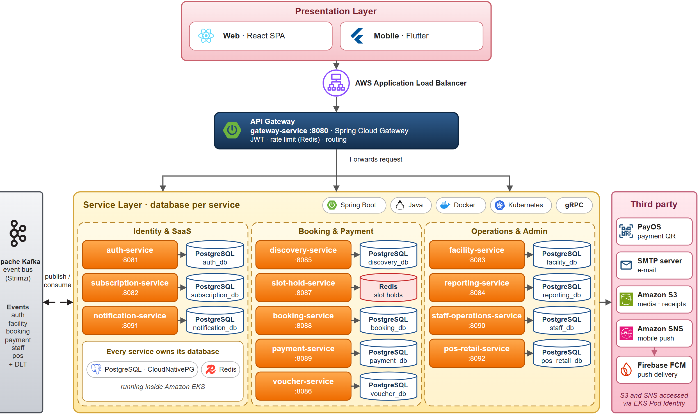

# FCourt Backend

FCourt là nền tảng đặt sân thể thao, xây dựng theo kiến trúc 13 microservice Spring Boot phía sau một API gateway, mỗi service có cơ sở dữ liệu riêng. Repository này chứa phần backend; các client và phần triển khai nằm ở các repository liên quan.

**Chức năng chính**

- **Khách hàng:** tìm chi nhánh và sân, giữ chỗ (300 giây), thanh toán chuyển khoản kèm biên lai, nhận vé QR, hủy đặt sân và yêu cầu hoàn tiền.
- **Chủ sân và nhân viên:** quản lý chi nhánh, sân, bảng giá, khung giờ mẫu, đơn đặt, biên lai, hoàn tiền, voucher, ca làm, check-in và bán lẻ (POS); xem dashboard và báo cáo.
- **Super admin:** duyệt hoặc từ chối tài khoản chủ sân, khóa người dùng, quản lý gói đăng ký SaaS.
- **Nền tảng:** xác thực JWT kèm refresh token, sự kiện Kafka giữa các service, cập nhật lịch realtime qua WebSocket, thông báo trong ứng dụng, email và push.

Web đang chạy: <https://fcourt.donan.site> (CloudFront + S3, API nằm dưới `/api`). Repository liên quan: `fcourt-web` (React), `fcourt-flutter` (ứng dụng Android), `fcourt-gitops` (manifest Argo CD), `fcourt-infra` (Terraform).

## Mục lục

[Kiến trúc](#kiến-trúc) · [Các service](#các-service) · [Công nghệ](#công-nghệ) · [Chạy nhanh](#chạy-nhanh-trên-máy-local) · [Build và test](#build-và-test-một-service) · [Cấu hình](#cấu-hình) · [Production](#production) · [CI/CD](#cicd-và-triển-khai) · [API](#điểm-vào-api) · [Tài liệu](#tài-liệu) · [Đóng góp](#đóng-góp)

## Kiến trúc



*Hình: kiến trúc microservices của FCourt (file draw.io có thể chỉnh sửa: [arch-3-1-microservices.drawio](docs/architecture/images/arch-3-1-microservices.drawio)).*

- **Presentation:** web React và ứng dụng Flutter, đi vào hệ thống qua AWS Application Load Balancer.
- **Gateway:** `gateway-service` là cổng vào duy nhất, kiểm tra JWT, giới hạn tốc độ (Redis) và định tuyến request tới các service.
- **Service:** 12 service nghiệp vụ, mỗi service sở hữu dữ liệu riêng (PostgreSQL; slot-hold-service dùng Redis); các service trao đổi sự kiện qua Kafka và gọi nhau bằng gRPC khi cần.
- **Bên thứ ba:** PayOS (thanh toán QR), SMTP (email), Amazon S3 (file), Amazon SNS và Firebase FCM (push).

Các service không đọc trực tiếp cơ sở dữ liệu của nhau mà giao tiếp qua REST, gRPC hoặc sự kiện Kafka. Hệ thống không có service registry (đã bỏ Eureka): gateway dùng danh sách địa chỉ tĩnh, xem [docs/architecture/spring-cloud.md](docs/architecture/spring-cloud.md).

## Các service

| Service (thư mục) | Port | Trách nhiệm | Dữ liệu / messaging |
|---|---|---|---|
| `gateway-service` | 8080 | Cổng vào duy nhất, xác thực JWT, định tuyến, giới hạn tốc độ, Swagger gộp | Redis |
| `auth-service` | 8081 | Đăng ký, đăng nhập, JWT/JWKS, refresh token, super admin (duyệt chủ sân, khóa tài khoản) | `auth_db`, Kafka |
| `subscription-service` | 8082 | Loại sân, gói đăng ký SaaS, mua và gia hạn qua PayOS | `subscription_db` |
| `facility-service` | 8083 | Chi nhánh, sân, khung giờ mẫu 30 phút | `facility_db`, Redis cache, Kafka |
| `reporting-service` | 8084 | Thống kê dashboard từ read model nạp bằng Kafka | `reporting_db`, Kafka |
| `discovery-service` | 8085 | Tìm kiếm chi nhánh/sân công khai và đánh giá | `discovery_db`, Redis cache, Kafka |
| `voucher-service` | 8086 | Voucher và kiểm tra hợp lệ (gRPC) | `voucher_db`, Kafka |
| `slot-hold-service` (thư mục `slot-hold-engine`) | 8087 | Giữ chỗ theo nguyên tắc tất cả hoặc không, hết hạn sau 300 giây (gRPC) | Redis |
| `booking-service` | 8088 | Đặt sân, lịch sử, tra cứu công khai, lịch realtime (`/ws-fcourt`) | `booking_db`, Redis, Kafka |
| `payment-service` | 8089 | Thanh toán, biên lai, yêu cầu hoàn tiền | `payment_db`, Redis cache, Kafka |
| `staff-operations-service` | 8090 | Phân công nhân viên, ca làm, check-in, khách vãng lai | `staff_db`, Kafka |
| `notification-service` | 8091 | Thông báo trong ứng dụng, email và push | `notification_db`, Kafka |
| `pos-retail-service` | 8092 | Danh mục bán lẻ, tồn kho, hóa đơn POS | `pos_retail_db`, Kafka |

Trong báo cáo dự án và sơ đồ, service giữ chỗ có tên slot-hold-service; thư mục, tên image và đường dẫn CI vẫn là `slot-hold-engine`. Chi tiết từng service nằm trong `README.md` của thư mục tương ứng (nếu có).

## Công nghệ

Java 21, Spring Boot 3.5 (`gateway-service` dùng Spring Boot 4.0 với Spring Cloud Gateway trên WebFlux), Maven (mỗi service là một project độc lập, không có root POM), PostgreSQL 16 với Flyway, Redis 7, Apache Kafka, gRPC (giữ chỗ an toàn, kiểm tra voucher), AWS S3 lưu file, Docker. Production: AWS EKS, Argo CD, Terraform.

## Yêu cầu

- Docker với Compose v2 (khoảng 4,5 GB RAM cho profile `core`, 7,5 GB cho `all`)
- JDK 21 và Maven 3.9+ (chỉ cần khi build hoặc test ngoài Docker; hầu hết service có sẵn `mvnw`)
- Python 3.12 (chỉ cần cho các script trong `tools/`)

## Chạy nhanh trên máy local

```bash
cp .env.example .env                          # không commit .env
docker compose --profile core up -d --build   # postgres, redis, kafka, gateway, auth, facility, booking, slot-hold, payment
# hoặc toàn bộ service: docker compose --profile all up -d --build
docker compose --profile all ps               # chờ đến khi healthy
curl http://localhost:8080/actuator/health
curl http://localhost:8080/api/public/branches
```

- Nếu không có `--profile`, Compose không khởi động gì. Các profile: `infra`, `core`, `all`, `mail`.
- Swagger của toàn bộ service: <http://localhost:8080/swagger-ui.html>.
- Dữ liệu mẫu do Flyway migration của từng service tạo ra. `bash tools/compose-seed.sh` đặt mật khẩu DEV dùng chung cho các tài khoản demo (`superadmin@demo.com`, `owner01..05@demo.com`, `staff01..05@demo.com`, `customer01..05@demo.com`; mật khẩu nằm trong script, chỉ dùng local) và đăng nhập từng vai trò; sau đó `bash tools/compose-smoke.sh` chạy bảng smoke test theo vai trò và request.
- Upload/download file cần khóa S3 thật trong `.env` (hỏi tech lead). Nếu không có, các chức năng khác vẫn hoạt động bình thường.
- Xóa toàn bộ dữ liệu: `docker compose --profile all down -v`.

## Build và test một service

Không có root POM nên cần trỏ Maven tới `pom.xml` của service (đúng lệnh CI chạy):

```bash
mvn -B -f booking-service/pom.xml clean verify      # compile + test
mvn -B -f booking-service/pom.xml spring-boot:run   # chạy trên máy host
docker compose --profile infra up -d                # postgres, redis, kafka cho lần chạy trên host
```

Integration test dùng Testcontainers nên Docker phải đang chạy. JaCoCo được cấu hình trong `pos-retail-service` (quy tắc phủ 80% dòng cho `com.fcourt.pos.service`, kiểm tra ở bước `verify`) và `staff-operations-service`; báo cáo HTML ở `<service>/target/site/jacoco/index.html`. Các kiểm tra liên service nằm trong `tools/system_tests` (chạy luồng qua gateway), `tools/demo_seed` và `tools/production_smoke`.

## Cấu hình

Cấu hình là các biến môi trường, có giá trị mặc định cho local trong `application.yml` của từng service và trong `docker-compose.yml`. Ghi đè trong `.env` (xem [.env.example](.env.example)); không commit giá trị thật.

| Biến | Mục đích |
|---|---|
| `POSTGRES_USER`, `POSTGRES_PASSWORD`, `POSTGRES_PORT` | PostgreSQL local |
| `GATEWAY_PORT`, `KAFKA_HOST_PORT`, `REDIS_HOST_PORT`, `MAILPIT_UI_PORT` | Port mở ra máy host |
| `SERVICE_MEM_LIMIT` | Giới hạn bộ nhớ cho mỗi container Java |
| `STORAGE_S3_BUCKET`, `STORAGE_S3_REGION` | Bucket và region S3 lưu file |
| `AWS_ACCESS_KEY_ID`, `AWS_SECRET_ACCESS_KEY` | Thông tin S3 dùng local (bí mật) |
| `AUTH_JWT_PRIVATE_KEY` | Khóa ký JWT cố định (PKCS8 PEM, bí mật); để trống thì dùng khóa tạm |
| `AUTH_GOOGLE_CLIENT_ID` | Đăng nhập Google |
| `PAYOS_CLIENT_ID`, `PAYOS_API_KEY`, `PAYOS_CHECKSUM_KEY` | Thanh toán PayOS (bí mật) |
| `NOTIFICATION_SMTP_HOST`, `NOTIFICATION_SMTP_USER`, `NOTIFICATION_SMTP_PASSWORD` | SMTP thật (mặc định: Mailpit) |
| `BOOKING_HOLD_SERVICE_TOKEN` | Token nội bộ giữa các service (giá trị DEV trong Compose) |
| `<NAME>_URI` (ví dụ `AUTH_SERVICE_URI`), `RATE_LIMIT_*`, `GATEWAY_*` | Định tuyến gateway, rate limit, CORS, Swagger |

Script cơ sở dữ liệu nằm trong `<service>/database/`; danh sách database ở `docker/postgres/services.txt`. Cố ý không có khóa ngoại giữa các service.

## Production

| Hạng mục | Giá trị |
|---|---|
| Web và API | <https://fcourt.donan.site> (API dưới `/api`, WebSocket `/ws-fcourt`) |
| Môi trường chạy | Amazon EKS cluster `fcourt-prod`, namespace `fcourt-prod` (các service) và `data` (PostgreSQL, Kafka, Redis), region ap-southeast-1 |
| Triển khai | GitHub Actions build image lên ECR, `fcourt-gitops` giữ manifest, Argo CD đồng bộ |
| Hạ tầng | Terraform trong `fcourt-infra` (VPC, EKS, ECR, S3, CloudFront, Route 53, ACM, SNS) |
| Local và cloud | Docker Compose chỉ dùng để phát triển local; production không dùng Compose |

## CI/CD và triển khai

1. Pull request chạy các workflow theo từng service trong `.github/workflows/` (lọc theo đường dẫn, `mvn verify` trên Java 21), cùng với các bước kiểm tra demo seed, gateway system test và production smoke runner.
2. Push lên `dev` chạy `build-push-images.yml`: chỉ build các service có thư mục thay đổi và đẩy `fcourt/<service>:<short-sha>` (và `latest`) lên Amazon ECR ở ap-southeast-1.
3. Job `update-gitops` sau đó cập nhật tag image trong `fcourt-gitops` (`kustomize edit set image`) khi biến repository `GITOPS_UPDATE_ENABLED` là `true`.
4. Argo CD đồng bộ `fcourt-gitops` vào cluster EKS (namespace `fcourt-prod`). Hạ tầng được quản lý trong `fcourt-infra` (Terraform).
5. Phát hành: tạo PR `dev` -> `main` với tiêu đề `merge: release vX.Y.Z` và merge bằng merge commit (không squash).

Chi tiết: [docs/architecture/aws-architecture.md](docs/architecture/aws-architecture.md).

## Điểm vào API

Client chỉ gọi gateway (`http://localhost:8080` ở local, `https://fcourt.donan.site` ở production, cùng origin dưới `/api`). Các prefix chính: `/api/auth/**`, `/api/public/**` (không cần token), `/api/bookings/**`, `/api/payments/**`, `/api/refunds/**`, `/api/vouchers/**`, `/api/subscriptions/**`, `/api/staff/**`, `/api/admin/**`, `/api/super-admin/**`, `/api/notifications/**` và WebSocket `/ws-fcourt`. `/api/internal/**` và `/actuator/**` không bao giờ được chuyển tiếp.

## Tài liệu

[docs/README.md](docs/README.md) là mục lục: kiến trúc, vận hành, phân tích nghiệp vụ và thư mục `docs/report/` cho báo cáo cuối kỳ.

## Đóng góp

- Nhánh: `main` (production), `dev` (tích hợp), `feature/<name>-<topic>`, `fix/<name>-<topic>`, `docs/<topic>`, `test/<topic>`.
- Commit message và tiêu đề PR viết bằng tiếng Anh, định dạng `type(scope): description`, trong đó `type` là một trong `feat`, `fix`, `docs`, `refactor`, `test`, `chore` và `scope` là service hoặc khu vực, ví dụ `fix(auth): handle expired refresh token`. Squash commit lấy theo tiêu đề PR. Phần mô tả PR có thể viết tiếng Việt.
- Mọi PR đều tạo vào `dev` (không push trực tiếp), cần ít nhất một review và CI xanh; điền `.github/PULL_REQUEST_TEMPLATE.md`.
- Chỉ sửa thư mục service của mình; việc khác hãy nhờ chủ sở hữu service đó.
- Không commit secret hoặc `.env`.
- Thêm service mới: tạo `<name>/`, thêm dòng `<name> <database>` vào `docker/postgres/services.txt`, đặt SQL trong `<name>/database/`, thêm `Dockerfile` (CI build mọi `*/Dockerfile`) và một mục trong Compose.

Nhóm: dự án SBA301 (GitHub organization `SBA301-SU26-BRO73`). Repository này chưa có file license.
