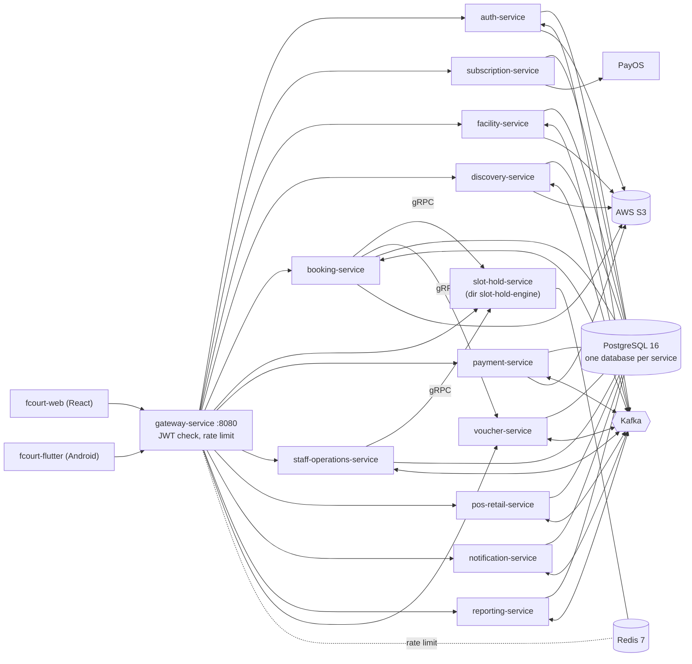

# FCourt Backend

FCourt is a court (sports field) booking platform. Customers search branches and courts, hold a slot, pay and check in; court owners and staff manage branches, schedules, vouchers, retail sales and reports; a super admin manages owners and subscription plans. This repository holds the backend: 13 Spring Boot services, each in its own folder with its own database, behind a single API gateway. Docker Compose is used for local development only; production runs on AWS EKS (ap-southeast-1) and is deployed with Argo CD (GitOps).

Live web: <https://fcourt.donan.site> (CloudFront + S3, the API is served under `/api`). Related repos: `fcourt-web` (React), `fcourt-flutter` (Android app), `fcourt-gitops` (Argo CD manifests), `fcourt-infra` (Terraform).

## Architecture



Services never read each other's database; they talk through REST, gRPC or Kafka events. There is no service registry (Eureka was removed): the gateway uses a static address list, see [docs/architecture/spring-cloud.md](docs/architecture/spring-cloud.md).

## Services

| Service (folder) | Port | Responsibility | Data / messaging |
|---|---|---|---|
| `gateway-service` | 8080 | Single entry point, JWT validation, routing, rate limiting, merged Swagger | Redis |
| `auth-service` | 8081 | Register, login, JWT/JWKS, refresh token, super admin (approve owners, lock accounts) | `auth_db`, Kafka |
| `subscription-service` | 8082 | Court types, SaaS subscription plans, PayOS purchase and renewal | `subscription_db` |
| `facility-service` | 8083 | Branches, courts, 30-minute time slot templates | `facility_db`, Redis cache, Kafka |
| `reporting-service` | 8084 | Dashboard statistics from a Kafka-fed read model | `reporting_db`, Kafka |
| `discovery-service` | 8085 | Public branch/court search and reviews | `discovery_db`, Redis cache, Kafka |
| `voucher-service` | 8086 | Vouchers and validation (gRPC) | `voucher_db`, Kafka |
| `slot-hold-engine` (slot-hold-service) | 8087 | All-or-nothing slot holds, 300 s expiry (gRPC) | Redis |
| `booking-service` | 8088 | Bookings, history, public lookup, realtime schedule (`/ws-fcourt`) | `booking_db`, Redis, Kafka |
| `payment-service` | 8089 | Payments, receipts, refund requests | `payment_db`, Redis cache, Kafka |
| `staff-operations-service` | 8090 | Staff assignments, shifts, check-in, walk-in | `staff_db`, Kafka |
| `notification-service` | 8091 | In-app, email and push notifications | `notification_db`, Kafka |
| `pos-retail-service` | 8092 | Retail catalog, stock, POS invoices | `pos_retail_db`, Kafka |

The slot-hold service is called slot-hold-service in the project report; its directory, image name and CI paths are still `slot-hold-engine`. Service details are in each folder's `README.md` where present.

## Tech stack

Java 21, Spring Boot 3.5 (`gateway-service` runs Spring Boot 4.0 with Spring Cloud Gateway on WebFlux), Maven (one independent project per service, no root POM), PostgreSQL 16 with Flyway, Redis 7, Apache Kafka, gRPC (slot safety, voucher validation), AWS S3 for files, Docker. Production: AWS EKS, Argo CD, Terraform.

## Prerequisites

- Docker with Compose v2 (about 4.5 GB RAM for profile `core`, 7.5 GB for `all`)
- JDK 21 and Maven 3.9+ (only to build or test outside Docker; most services also ship `mvnw`)
- Python 3.12 (only for the scripts under `tools/`)

## Quick start (local)

```bash
cp .env.example .env                          # never commit .env
docker compose --profile core up -d --build   # postgres, redis, kafka, gateway, auth, facility, booking, slot-hold, payment
# or every service: docker compose --profile all up -d --build
docker compose --profile all ps               # wait until healthy
curl http://localhost:8080/actuator/health
curl http://localhost:8080/api/public/branches
```

- Without a `--profile`, Compose starts nothing. Profiles: `infra`, `core`, `all`, `mail`.
- Swagger for all services: <http://localhost:8080/swagger-ui.html>.
- Sample data is created by each service's Flyway migrations. `bash tools/compose-seed.sh` sets a shared DEV password on the demo accounts (`superadmin@demo.com`, `owner01..05@demo.com`, `staff01..05@demo.com`, `customer01..05@demo.com`; the password is in the script, local only) and logs each role in; `bash tools/compose-smoke.sh` then runs a role-by-request smoke table.
- File upload/download needs real S3 keys in `.env` (ask the tech lead). Without them everything else still works.
- Reset all data: `docker compose --profile all down -v`.

Full guide (ports, memory, troubleshooting): [docs/operations/docker-compose.md](docs/operations/docker-compose.md). Recorded smoke run: [docs/operations/smoke-test-local.md](docs/operations/smoke-test-local.md).

## Build and test one service

There is no root POM, so point Maven at the service's `pom.xml` (the same command CI runs):

```bash
mvn -B -f booking-service/pom.xml clean verify      # compile + tests
mvn -B -f booking-service/pom.xml spring-boot:run   # run on the host
docker compose --profile infra up -d                # postgres, redis, kafka for a host run
```

Integration tests use Testcontainers, so Docker must be running. JaCoCo is configured in `pos-retail-service` (80% line-coverage rule on `com.fcourt.pos.service`, checked at `verify`) and `staff-operations-service`; the HTML report is `<service>/target/site/jacoco/index.html`. Cross-service checks live in `tools/system_tests` (gateway flow runner), `tools/demo_seed` and `tools/production_smoke`.

## Configuration

Settings are environment variables with local defaults in each `application.yml` and in `docker-compose.yml`. Put overrides in `.env` (see [.env.example](.env.example)); never commit values.

| Variable | Purpose |
|---|---|
| `POSTGRES_USER`, `POSTGRES_PASSWORD`, `POSTGRES_PORT` | Local PostgreSQL |
| `GATEWAY_PORT`, `KAFKA_HOST_PORT`, `REDIS_HOST_PORT`, `MAILPIT_UI_PORT` | Host ports |
| `SERVICE_MEM_LIMIT` | Memory limit per Java container |
| `STORAGE_S3_BUCKET`, `STORAGE_S3_REGION` | S3 bucket and region for files |
| `AWS_ACCESS_KEY_ID`, `AWS_SECRET_ACCESS_KEY` | Local S3 credentials (secret) |
| `AUTH_JWT_PRIVATE_KEY` | Fixed JWT signing key (PKCS8 PEM, secret); empty means an ephemeral key |
| `AUTH_GOOGLE_CLIENT_ID` | Google sign-in |
| `PAYOS_CLIENT_ID`, `PAYOS_API_KEY`, `PAYOS_CHECKSUM_KEY` | PayOS payments (secret) |
| `NOTIFICATION_SMTP_HOST`, `NOTIFICATION_SMTP_USER`, `NOTIFICATION_SMTP_PASSWORD` | Real SMTP (default: Mailpit) |
| `BOOKING_HOLD_SERVICE_TOKEN` | Internal service token (DEV value in Compose) |
| `<NAME>_URI` (e.g. `AUTH_SERVICE_URI`), `RATE_LIMIT_*`, `GATEWAY_*` | Gateway routing, rate limit, CORS, Swagger: [docs/operations/gateway.md](docs/operations/gateway.md) |

Database scripts live in `<service>/database/`; the database list is `docker/postgres/services.txt`. Cross-service foreign keys are intentionally absent.

## CI/CD and deployment

1. Pull requests run the per-service workflows in `.github/workflows/` (path-filtered, `mvn verify` on Java 21), plus the demo seed, gateway system test and production smoke runner checks.
2. A push to `dev` runs `build-push-images.yml`: it builds only the services whose folder changed and pushes `fcourt/<service>:<short-sha>` (and `latest`) to Amazon ECR in ap-southeast-1.
3. The `update-gitops` job then bumps the image tag in `fcourt-gitops` (`kustomize edit set image`) when the repository variable `GITOPS_UPDATE_ENABLED` is `true`.
4. Argo CD syncs `fcourt-gitops` into the EKS cluster (namespace `fcourt-prod`). Infrastructure is managed in `fcourt-infra` (Terraform).
5. Release: open a PR `dev` -> `main`.

Details: [docs/operations/ci-image-build.md](docs/operations/ci-image-build.md), [docs/architecture/aws-architecture.md](docs/architecture/aws-architecture.md).

## API entry points

Clients call only the gateway (`http://localhost:8080` locally, `https://fcourt.donan.site` in production, same origin under `/api`). Main prefixes: `/api/auth/**`, `/api/public/**` (no token), `/api/bookings/**`, `/api/payments/**`, `/api/refunds/**`, `/api/vouchers/**`, `/api/subscriptions/**`, `/api/staff/**`, `/api/admin/**`, `/api/super-admin/**`, `/api/notifications/**`, and WebSocket `/ws-fcourt`. `/api/internal/**` and `/actuator/**` are never forwarded. Full route table and public paths: [docs/operations/gateway.md](docs/operations/gateway.md).

## Documentation

[docs/README.md](docs/README.md) is the index: architecture, operations, business analysis, and the `docs/report/` folder for the final report.

## Contributing

- Branches: `main` (production), `dev` (integration), `feature/<name>-<topic>`, `fix/<name>-<topic>`, `docs/<topic>`, `test/<topic>`.
- Commit messages and PR titles in English, format `type(scope): description`, with `type` one of `feat`, `fix`, `docs`, `refactor`, `test`, `chore` and `scope` the service or area, e.g. `fix(auth): handle expired refresh token`. The squash commit uses the PR title. PR bodies may be Vietnamese.
- Open every PR against `dev` (no direct pushes), get at least one review and a green CI; fill in `.github/PULL_REQUEST_TEMPLATE.md`.
- Change only your own service folder; ask its owner for anything else.
- Never commit secrets or `.env`.
- Adding a service: create `<name>/`, add `<name> <database>` to `docker/postgres/services.txt`, put SQL in `<name>/database/`, add a `Dockerfile` (CI builds every `*/Dockerfile`) and a Compose entry.

Team: SBA301 project (GitHub organization `SBA301-SU26-BRO73`). No license file is present in this repository.
