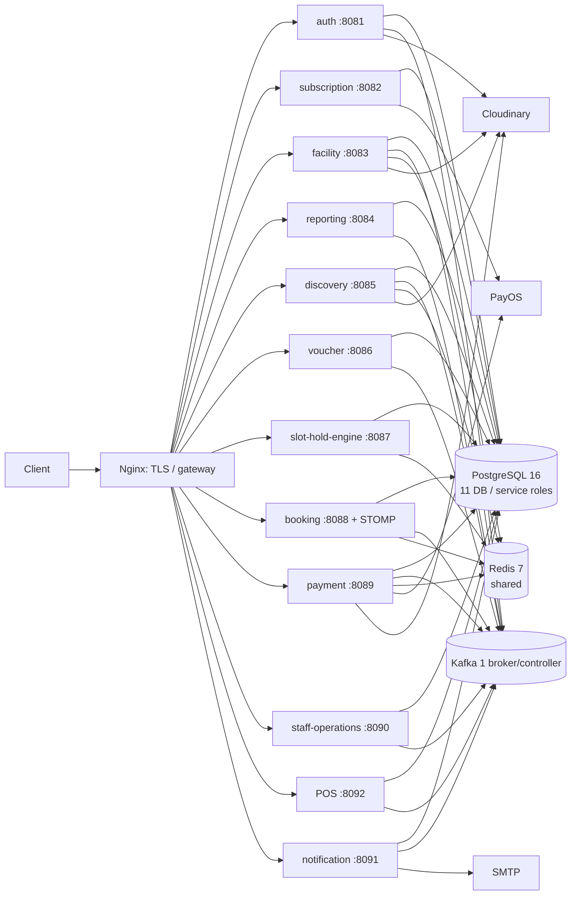
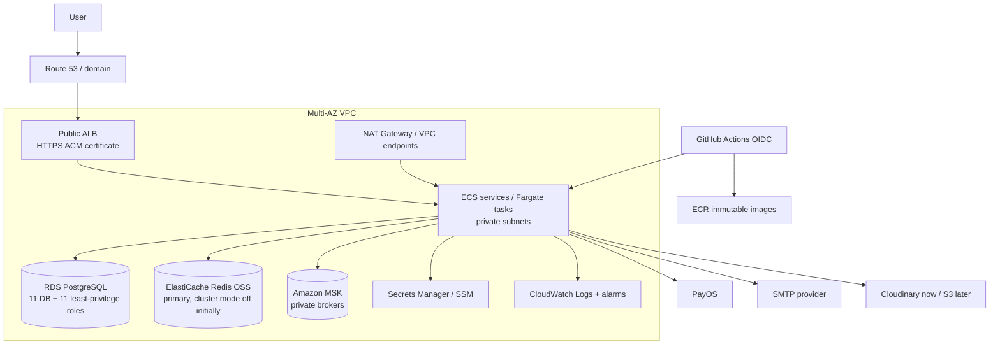

# Kiến trúc AWS và phương án triển khai FCOURT

Tài liệu thiết kế cho SCRUM-100, không phải xác nhận đã triển khai. Cấu hình Compose được đọc từ `origin/feature/minh-scrum-100-production-deployment`; nhánh hiện tại không có thư mục `deploy/`. Các trích dẫn dạng `path:line` chỉ vị trí trong source; draft Compose được ghi rõ tên nhánh.

## 1. Hiện trạng

Port HTTP là mặc định của cấu hình dịch vụ. POS mặc định chạy ở `8092`; notification giữ mặc định `8091` (`pos-retail-service/src/main/resources/application.yml:1-3`, `notification-service/src/main/resources/application.yml:1-3`). Compose draft trên nhánh `feature/minh-scrum-100-production-deployment` ghi đè port notification theo cấu hình triển khai riêng.

Memory là **ước tính khởi điểm**, không phải số đo: Spring Boot/JVM, Kafka clients và mỗi service có datasource/client; Compose giới hạn Hikari ở 5 kết nối (`deploy/compose.yml` trên nhánh draft, ví dụ dòng 97–100, 145–148, 198–205). Tạm đặt 512 MiB cho workload nhỏ và 768 MiB–1 GiB cho dịch vụ nhiều tích hợp/consumer; chạy soak test rồi chỉnh theo heap, RSS, GC và tải thực. Hãy đặt heap tối đa khoảng 60–70% giới hạn container để còn chỗ cho metaspace, thread và native memory.

| Service | HTTP | Datastore | Gọi đồng bộ (đã biết từ cấu hình) | Bất đồng bộ | Stateful? | RAM JVM ước tính |
|---|---:|---|---|---|---|---:|
| auth | 8081 | `auth_db` | Google JWKS; tuỳ luồng gọi staff | Kafka `fcourt.auth.events` | Có (DB, signing key ổn định) | 768 MiB |
| subscription | 8082 | `subscription_db` | PayOS, auth/JWKS | Không thấy Kafka producer/consumer trong module hiện tại; Compose draft vẫn khởi động Kafka dependency | Có (DB) | 512 MiB |
| facility | 8083 | `facility_db`; Redis khi realtime bật | auth, subscription, discovery | Kafka `facility.branch-updated.v1`; Redis Pub/Sub nếu bật | Có (DB/outbox) | 768 MiB |
| reporting | 8084 | `reporting_db` | auth, facility, subscription | Kafka `fcourt.payment.events`, `fcourt.staff.events`, `facility.branch-updated.v1` | Có (read model/DB) | 768 MiB |
| discovery | 8085 | `discovery_db`; Redis cache | auth, facility, booking | Kafka `facility.branch-updated.v1` | Có (DB/cache) | 768 MiB |
| voucher | 8086 | `voucher_db` | facility, auth/JWKS | Kafka; topic phụ thuộc tích hợp voucher | Có (DB) | 512 MiB |
| slot-hold-engine | 8087; gRPC 9087 | Redis là trạng thái giữ chỗ (không thấy PostgreSQL config/module trong service) | discovery; gRPC được staff gọi đến | Redis Pub/Sub `fcourt:slot-changes` | **Có, trạng thái nóng ở Redis** | 512 MiB |
| booking | 8088; gRPC 9088 | `booking_db`; Redis khi realtime bật | auth/JWKS, hold engine, facility, POS; có luồng booking/payment | Kafka event/outbox; Redis Pub/Sub/STOMP | Có (DB, outbox; kết nối WebSocket dài hạn) | 1 GiB |
| payment | 8089 | `payment_db`, Redis cache | booking, facility, auth; PayOS callback/provider | Kafka `fcourt.payment.events` | Có (DB; Redis cache có thể tái tạo) | 768 MiB |
| staff-operations | 8090 | `staff_db` | auth, facility, discovery, booking; gRPC hold/booking | Kafka `fcourt.staff.events` | Có (DB/outbox) | 768 MiB |
| pos-retail | 8092 | `pos_retail_db` | auth, staff, facility, booking | Kafka `fcourt.pos.events` | Có (DB) | 512 MiB |
| notification | 8091 mặc định (draft triển khai có thể ghi đè) | `notification_db` | SMTP/email | Kafka auth/payment/booking events, DLT | Có (DB/idempotency) | 512 MiB |

Hiện trạng là **11 PostgreSQL databases cho 11 service có datasource**; slot-hold-engine giữ hold trong Redis và không khai báo datasource tại `slot-hold-engine/src/main/resources/application.yml:1-17`. Ví dụ datasource: `auth-service/src/main/resources/application.yml:13-19`, `booking-service/src/main/resources/application.yml:6-9`; Compose draft tạo role riêng (`deploy/compose.yml` trên nhánh draft, dòng 37–45 và cấu hình từng ứng dụng). Topic reporting thấy tại `reporting-service/src/main/resources/application.yml:46-50`; luồng HTTP chính được cấu hình ở `discovery-service/src/main/resources/application.yml:65-85`, `payment-service/src/main/resources/application.yml:40-48`, `pos-retail-service/src/main/resources/application.yml:31-42` và `staff-operations-service/src/main/resources/application.yml:37-50`.

### Sơ đồ hiện tại (Compose draft SCRUM-100)

Compose draft keeps all application services on a private network and publishes only Nginx ports 80/443 (`deploy/compose.yml` on nhánh draft, dòng 2–9, 32–35; Nginx service ở cuối file). PostgreSQL/Kafka/Redis share one host and persistent volumes; Kafka is explicitly one broker/controller with replication factor 1 (same file, dòng 70–84). This is useful for a demo, but a host, disk, DB, Redis, or Kafka failure takes down the whole stack. Draft README itself calls this single-node and not HA (`deploy/README.md` trên nhánh draft, phần đầu).

## 2. Sơ đồ mục tiêu đề xuất

Kiến trúc này đích đến cho dịch vụ chạy dài hạn, nhưng chỉ triển khai HA sau khi có nhu cầu vận hành/khôi phục rõ ràng. RDS cùng Redis/MSK nằm private; ALB chỉ route HTTP và `/ws-fcourt` đến booking. Dùng ALB idle timeout lớn hơn heartbeat WebSocket (ví dụ 120–300 giây theo heartbeat thực tế); ALB hỗ trợ WebSocket upgrade. Stickiness không thay thế broadcast liên instance. SCRUM-108 nêu các booking pod đều subscribe cùng Redis Pub/Sub, sự kiện không bền vững và client phải đồng bộ lại qua HTTP khi reconnect (`docs/SCRUM-108.md:8-20,23-34`).

## 3. So sánh lựa chọn

| Chủ đề | (a) EC2 + Docker Compose | (b) ECS + Fargate | (c) EKS |
|---|---|---|---|
| 12 dịch vụ | 12 container trên một EC2 lớn; giữ gần topology draft. Có thể nhân bản host nhưng Compose không orchestration nhiều host. | Một ECS service/task definition mỗi service; task trên Fargate. Autoscaling theo CPU/memory/request; deploy/rollback ECS. | Deployment/Service cho mỗi app, HPA, probes, requests/limits; cần cluster, node groups (hoặc Fargate profiles), ingress/controller. 12 workload vẫn cần cấu hình đầy đủ. |
| Network / gateway | Private Docker network; Nginx trong Compose; SG chỉ mở 80/443 và SSH giới hạn. | ALB public, ECS tasks private; target group theo service, WAF tuỳ nhu cầu; gRPC giữ private route. | ALB AWS Load Balancer Controller hoặc ingress; VPC CNI, security groups, private nodes. Nhiều thành phần và IAM wiring hơn. |
| Kafka | Demo: một broker self-run cùng host/EC2 (giống draft), chấp nhận mất/khôi phục log và không HA. | Thử nghiệm có thể broker self-run trên ECS EC2; dài hạn MSK (managed, HA phù hợp). Kafka không hợp task Fargate ephemeral nếu phải tự vận hành broker/storage. | Thử nghiệm operator/statefulset có storage, nhưng phức tạp. Dài hạn thường MSK; không tự-host chỉ để chứng minh dùng Kubernetes. |
| Redis | Redis self-run trên host + volume; đơn giản nhưng SPOF và backup/restore do đội quản lý. | Demo Redis self-run; dài hạn ElastiCache Redis OSS/Valkey node-based, Multi-AZ/replica khi cần. Ban đầu primary-only, cluster mode off để tương thích script. | Self-run Redis operator/statefulset cần failover/persistence; ưu tiên ElastiCache bên ngoài cluster. |
| PostgreSQL | PostgreSQL container + EBS, backup tự làm; không hợp dữ liệu dài hạn nếu chưa drill restore. | RDS PostgreSQL Multi-AZ. Một DB instance/cluster, 11 logical databases, 11 app roles; dễ quản lý hơn 11 instance. Tách vài instance khi tải, bảo mật, cửa sổ bảo trì hoặc blast radius yêu cầu. | RDS như ECS. Không đặt dữ liệu chính trong pod. |
| WebSocket | Nginx proxy HTTP/1.1 Upgrade; read timeout > heartbeat, giới hạn connections. Một booking instance tránh bài toán fan-out nhưng không HA. | ALB tới booking task, tăng idle timeout. Stickiness có thể giảm reconnect churn nhưng không đồng bộ sự kiện; giữ Redis Pub/Sub và test fan-out. | ALB ingress tới booking service, chỉnh timeout tương tự. Service/pod scale-out vẫn phải giữ Redis fan-out. |
| Secrets | SSM Parameter Store/Secrets Manager và IAM instance role; tránh `.env` bất động trên EC2, rotate thủ công theo runbook. | Secrets Manager/SSM injection vào task, execution/task roles least privilege; không truyền secret trong image. | Secrets Manager CSI driver/External Secrets hoặc workload identity; thêm quyền IAM mapping và rotation. |
| Images / CI | ECR; GitHub Actions OIDC build, scan/tag SHA, cập nhật Compose/SSH hoặc SSM Run Command. CI hiện tại chủ yếu verify từng module; chưa thấy pipeline deploy chung. | ECR + GitHub Actions OIDC, build 12 image, deploy ECS task definitions theo SHA; PR verify trước, deploy staging rồi promote. | ECR + GitHub Actions OIDC, build rồi `helm`/manifests deploy; quản lý quyền cluster, chart, rollout và policy. |
| Logs / metrics | Docker logs/CloudWatch Agent, CloudWatch alarms; metric host/container phải cấu hình. | awslogs → CloudWatch Logs; Container Insights, ALB/ECS/RDS/MSK alarms. Chi phí ingest/retention cần budget. | CloudWatch Container Insights/Fluent Bit; Prometheus/Grafana tuỳ chọn. Metrics cardinality và cluster addons là gánh vận hành. |
| Failure / scale | Host hết RAM/disk = cả hệ thống dừng; deploy restart làm gián đoạn; vertical scale đơn giản, horizontal khó. | Task tự thay thế, AZ placement, autoscaling; vẫn phụ thuộc RDS/MSK/Redis, NAT/ALB và quota. Cần timeout/retry/readiness kiểm chứng. | Pod/node/AZ thay thế, HPA; cluster/addon/API/IAM/CNI/ingress upgrades tạo thêm failure modes. Kubernetes không tự làm DB/broker HA. |
| Kỹ năng | Docker, Linux, systemd, EC2, backup, firewall, TLS. Dễ nhất với đội nhỏ. | ECS/Fargate, IAM, ALB/VPC, RDS, CloudWatch, CI OIDC; cân bằng giữa quản lý và vận hành. | Kubernetes, Helm, networking/CNI, IAM/IRSA, autoscaling, ingress, upgrades, observability, incident response. Dốc học lớn. |
| **Chi phí tháng (ước tính)** | **$150–600** demo always-on: EC2 khoảng 8 vCPU/32 GiB, EBS, IPv4, backup, DNS/TLS; có thể thấp hơn khi tắt ngoài giờ. Không HA. | **$900–3,000** baseline chạy liên tục: tổng 12 service khoảng 8–16 vCPU/16–32 GiB, ALB, 1 RDS Multi-AZ cỡ nhỏ/vừa, ElastiCache, MSK tối thiểu 3 broker, NAT/endpoints, logs/backup. | **$1,200–4,000+** với workload tương tự ECS, cộng control plane EKS, worker capacity, cluster addons, ALB/NAT/logging. Tăng khi Multi-AZ, lớn tải hoặc retention cao. |

**Tất cả con số chi phí trên là ước tính định hướng**, không phải báo giá. Giả định 730 giờ/tháng, một môi trường, giá On-Demand, không Savings Plans/Reserved, chưa gồm VAT, phí PayOS/SMTP, egress lớn, tải cao hoặc người trực vận hành. Chênh lệch region/instance family/capacity và NAT/data transfer có thể lớn; chốt bằng AWS Pricing Calculator sau khi xác định region, kích cỡ và HA. Các khoản dịch vụ thay đổi theo cấu hình, dung lượng, request và data transfer; xem [Fargate](https://aws.amazon.com/fargate/pricing/), [MSK](https://aws.amazon.com/msk/pricing/), [ElastiCache](https://aws.amazon.com/elasticache/pricing/) và [RDS PostgreSQL](https://aws.amazon.com/rds/postgresql/pricing/). MSK tính broker/storage/throughput; ElastiCache theo node-hour hoặc serverless usage; RDS có instance/storage/backup và Multi-AZ làm tăng chi phí ([MSK pricing](https://aws.amazon.com/msk/pricing/), [ElastiCache pricing](https://aws.amazon.com/elasticache/pricing/), [RDS pricing](https://aws.amazon.com/rds/postgresql/pricing/)).

GitHub Actions hiện có workflow verify riêng cho từng module, ví dụ `.github/workflows/booking-service.yml` và `.github/workflows/facility-service.yml`; chưa thấy workflow build/deploy toàn bộ stack. SCRUM-100 nên bổ sung pipeline riêng, quyền AWS OIDC tối thiểu và phê duyệt môi trường; không lưu access key lâu dài trong GitHub Secrets.

## 4. Khuyến nghị

**Demo/defence:** dùng EC2 + Compose draft đã được rà soát, một máy đủ RAM, EBS mã hoá, ECR cho image theo immutable commit SHA, TLS/domain, SG chỉ public 80/443; giữ PostgreSQL/Redis/Kafka private và có snapshot/backup. Đây là cách nhanh nhất để đưa đủ 12 service lên AWS và kể được câu chuyện kiến trúc microservice mà đội có thể tự debug. Có thể dừng compute ngoài giờ nếu demo không chạy liên tục; xác nhận cách dừng mà vẫn giữ volume và dữ liệu. Nêu rõ đây là demo single-node, không cam kết HA.

**Dài hạn:** chọn **ECS on Fargate + ALB + RDS PostgreSQL + ElastiCache + MSK**. Tách vận hành ứng dụng khỏi OS/node và giảm phần học/patch/upgrade so với EKS; vẫn cho phép mỗi service scale/deploy riêng, chạy private networking, log/metric và CI/CD có kiểm soát. Gom 11 DB vào một RDS ban đầu để tiết kiệm vận hành, nhưng dùng đúng 11 DB và 11 role, pool nhỏ, giới hạn tổng connection; tách khi có bằng chứng tải/nhu cầu độc lập.

**EKS là đường tiến hoá**, không phải lựa chọn mặc định vì “ấn tượng”. Hãy cân nhắc sau khi team đã có người trực vận hành, CI/CD, quan sát metrics, xử lý sự cố, và Kubernetes skill đủ để sở hữu cluster. Nếu vẫn chọn EKS, layout tối thiểu: control plane managed; VPC 3 AZ với private managed node group ít nhất 2–3 nodes để app có chỗ phân tán; public ALB controller; namespace `fcourt`; 12 Deployment/Service, requests/limits/probes; autoscaler; External Secrets/Secrets Store CSI; CloudWatch/Fluent Bit; ECR; RDS, ElastiCache và MSK bên ngoài cluster. Điều sẽ làm đội đau: nâng version/control-plane/addons/CNI, IAM workload identity, networking/quota, pod disruption, Helm drift, debugging giữa ALB–Ingress–Service–Pod, và chi phí idle. Thực hành orchestration có thể làm bằng cluster nhỏ tạm thời; không cần đặt dữ liệu stateful production trong Kubernetes.

## 5. Rủi ro riêng của dự án

- **Kafka sizing/khôi phục:** draft chỉ có 1 broker/controller, RF=1; chấp nhận được cho demo, không có replication/failover (`deploy/compose.yml` trên nhánh draft, dòng 70–83). Dài hạn dùng MSK ba broker (hoặc cấu hình đủ theo SLA), partitions/retention dựa trên throughput, topic/consumer groups, DLT, disk/lag alarms. Chốt replay/idempotency và retention trước khi nhận thanh toán thật.
- **Redis slot-hold:** hold engine chạy Lua atomic trên Redis (`slot-hold-engine/src/main/resources/redis/acquire.lua:3-16`, `release.lua:5-14`, `sweep.lua:3-12`); SCRUM-108 ghi rõ shared sorted-set index không khai báo hết `KEYS`, và giả định single Redis node, không Redis Cluster (`docs/SCRUM-108.md:54-65` và phần “Redis scripts touch the shared index key…” ở cuối tài liệu). Chọn ElastiCache node-based, cluster mode off và verify khả năng script/failover của engine; không chuyển sang cluster mode trước khi sửa key-slot/script và kiểm thử. Redis Pub/Sub không bền vững; clients resync HTTP khi nối lại (`docs/SCRUM-108.md:15-20`).
- **WebSocket fan-out:** mỗi booking pod subscribe Redis Pub/Sub, ALB stickiness không phát message sang pod khác. Dùng cùng một Redis Pub/Sub/channel, kiểm thử hai client trên task khác nhau, autoscale/reconnect, connection cap, heartbeat và idle timeout; schedule invalidate có thể mất, nên client fetch schedule lại.
- **Flyway và triển khai song song:** từng app tự migrate DB khi khởi động; một deployment đồng loạt có thể đua migration nếu chạy nhiều replica. Deploy theo thứ tự hoặc có migration job/lock; migration tương thích ngược với image trước đó. Facility còn baseline-on-migrate tại V2, các service khác tắt baseline (`facility-service/src/main/resources/application.yml:17-21`, `auth-service/src/main/resources/application.yml:27-28`). Xác nhận DB init từ SQL legacy hay DB rỗng; không để init script và Flyway cùng sở hữu schema không thống nhất.
- **DB roles / pool:** mỗi database có role/password riêng; không cấp role `postgres` cho app. Hikari max 10 ở YAML, draft giới hạn 5: tính tổng pool của 12 services/replicas cộng migration/admin connections so với giới hạn RDS. Dùng Secrets Manager và rotation có kiểm thử, không nhúng password vào task definition/image.
- **Tokens nội bộ:** mọi môi trường phải provision đúng các cặp token/chủ thể cho `X-Internal-Service-Token`, `X-Service-Token`/POS và reservation token; reservation secret tối thiểu 32 ký tự, thiếu thì đóng an toàn (503) (`facility-service/src/main/java/com/fcourt/facility/api/ReservationController.java:24-35`; `facility-service/src/main/resources/application.yml:72-76`; `booking-service/src/main/java/com/fcourt/booking/BookingVoucherController.java:17-30`; `pos-retail-service/src/main/resources/application.yml:39-40`). Bổ sung cả hold token giữa booking/hold engine, token staff/payment/POS trong cấu hình Compose draft (`deploy/compose.yml` trên nhánh draft, dòng 177–205). Dùng secret riêng theo môi trường, đưa đúng consumer, rotate có kế hoạch; không log header/token.
- **Port / release gate:** POS mặc định dùng `8092` và notification mặc định dùng `8091`; các triển khai có thể ghi đè qua `SERVER_PORT`. Cần integration config check cho tất cả port/target (`notification-service/src/main/resources/application.yml:1-3`, `pos-retail-service/src/main/resources/application.yml:1-3`). Draft README cũng nêu gRPC counter TLS là release gate (`deploy/README.md` trên nhánh draft, mục “gRPC counter operations”).
- **Storage / provider:** Cloudinary đang được dùng cho ảnh; chuyển S3 cần adapter, IAM least privilege, bucket private, URL signed/CDN và migrate ảnh, không chỉ thêm bucket (`discovery-service/src/main/resources/application.yml:52-63`). PayOS, email/SMTP và auth JWT signing key/JWKS đều cần cấu hình/rotation; key JWT phải ổn định qua restart (`auth-service/src/main/resources/application.yml:45-54`, `subscription-service/src/main/resources/application.yml:34-44`).

## 6. Lộ trình SCRUM-100 (Jira-ready)

Mỗi đầu việc nhắm 1 người / 1–2 ngày; tách nhỏ nếu vượt phạm vi. Thực hiện theo thứ tự, làm rõ acceptance criteria trước khi áp dụng production.

1. **Chốt kiến trúc demo và cấu hình môi trường** — region, domain, ai trả tiền, external integrations, ports, health endpoints, replicas=1.
2. **Tạo IaC skeleton** — Terraform/CDK, state remote có locking/encryption, naming/tagging; plan review, không đưa secret vào state nếu tránh được.
3. **Tạo VPC và security groups** — public/private subnets, route, egress, SSH/SSM, chỉ gateway được public; tách SG data layer.
4. **Tạo ECR repositories** — 12 repo, immutable tags, lifecycle policy, image scanning; kiểm tra build context/Dockerfile cho các service thiếu Dockerfile.
5. **Tạo secret inventory** — map mỗi secret tới producer/consumer, môi trường, rotation owner; tạo SSM/Secrets Manager entries rỗng qua IaC, không ghi giá trị vào repo.
6. **Tạo PostgreSQL demo** — RDS hoặc EC2 demo theo lựa chọn, 11 databases và 11 roles/password riêng; thử Flyway migration service đầu tiên.
7. **Tạo Redis demo** — primary, persistence/backup phù hợp demo; xác minh Lua script và cluster mode off; đo memory/latency.
8. **Tạo Kafka demo** — self-host một broker có volume hoặc MSK; tạo topics/partitions/retention, kiểm tra producer/consumer, DLT và restart/replay.
9. **Build/publish một service end-to-end** — auth image SHA → ECR → deploy riêng → health check, logs, DB role, secret access, rollback image.
10. **Tạo gateway HTTPS/domain** — ALB/Nginx, ACM/Let's Encrypt, DNS, routing, security headers/rate limit; test HTTP redirect và certificate renewal.
11. **Thêm WebSocket route** — booking `/ws-fcourt`, upgrade/heartbeat/idle timeout, origin/capacity limits; smoke test client reconnect.
12. **Chuẩnizar CI/CD OIDC** — GitHub Actions role least privilege; verify → build/tag → ECR → deploy staging; giữ production approval/rollback.
13. **Triển khai 11 service còn lại** — theo nhóm dependency, readiness, correct ports, secrets và DB; smoke test mỗi service trước nhóm tiếp.
14. **Thêm observability cơ bản** — CloudWatch logs có retention, dashboard CPU/memory/restarts/ALB/RDS/Redis/Kafka lag, alarms và owner/on-call path.
15. **Backup và restore drill** — backup PostgreSQL, Redis/Kafka theo chính sách; khôi phục vào môi trường tách biệt, kiểm tra dữ liệu và thời gian phục hồi.
16. **Smoke test tích hợp** — signup/login, discovery, hold, booking, PayOS sandbox, staff/POS flow, notification, reporting; kiểm tra internal token và gRPC TLS.
17. **Regression và phát hành demo** — chạy workflow verify hiện có, system tests/smoke runner, kiểm tra tải WebSocket cơ bản, ghi kết quả/known limitations và rollback steps.
18. **Quyết định bước HA** — review chi phí thực tế, tải, restore drill, connection limits và người vận hành; quyết định ECS/Fargate managed-data transition hay giữ demo ngắn hạn.

## 7. Chưa biết / cần xác nhận

- AWS Region ưu tiên (cần cân nhắc độ trễ tới người dùng, PayOS/SMTP và dịch vụ được hỗ trợ)?
- Đã có domain chưa, ai quản DNS và ai phát hành/duy trì chứng thư?
- Ai chịu trách nhiệm thanh toán và theo dõi AWS Budget/alarms? Có hạn mức tháng cho demo không?
- Cần Multi-AZ ngay từ demo hay chỉ cho giai đoạn chạy dài hạn?
- SLO mong muốn (uptime, RPO/RTO) và retention cho DB, Kafka, log, email/event?
- Có dữ liệu thật/PII hay chỉ fixture/demo? Bao lâu phải xoá/ẩn danh?
- Số người dùng đồng thời, booking peak, WebSocket connections và dung lượng uploads dự kiến?
- Tài khoản PayOS sandbox/production, SMTP provider, Cloudinary và kế hoạch/chủ sở hữu chuyển ảnh sang S3?

